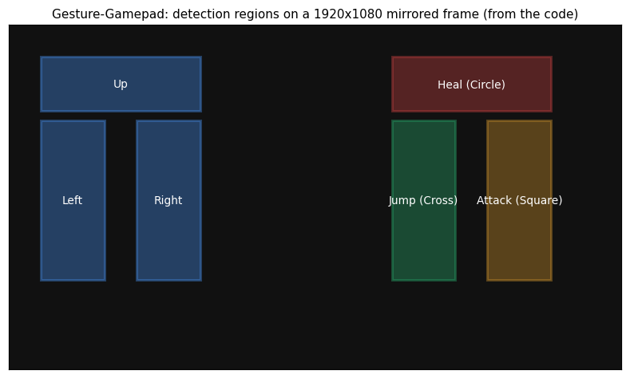

# Gesture Gamepad

Play PC games with coloured markers in front of a webcam. OpenCV watches screen-sized regions of the camera image for **green**, and each region is wired to a virtual **DualShock 4** controller. Hold a green object in a region and the game sees a button press or a stick push.



*The six regions as laid out in the code, on the mirrored 1920×1080 frame. This is a schematic, not a screenshot.*

## How it works

1. The webcam frame is mirrored and resized to your screen resolution.
2. Six rectangular regions of interest (ROIs) are checked every frame. Each is converted to HSV and masked for green (`H 35–85`). If more than 1500 pixels match, that region counts as active.
3. Active regions drive a virtual gamepad created with `vgamepad` (`VDS4Gamepad`):

| Region | Gamepad input |
|---|---|
| Left-bottom | Left stick left |
| Middle-bottom | Left stick right |
| Top-left | Left stick up |
| Right-bottom, inner | Cross (jump) |
| Right-bottom, outer | Square (attack) |
| Top-right | Circle (heal) |

The mapping was built for a side-scrolling action game. Change the `Jump`, `Attack` and `Heal` functions to remap it.

## Run it

1. Install the [ViGEmBus driver](https://github.com/nefarius/ViGEmBus). `vgamepad` needs it to create a virtual controller on Windows.
2. Install the dependencies:
   ```bash
   pip install opencv-python numpy pyautogui vgamepad
   ```
3. Run `python gesture_gamepad.py`. Hold something green (a marker cap, tape, a sticky note) in the regions. The game must see the virtual controller as player input.

Notes:
- The ROI coordinates are hard-coded for a 1920×1080 screen, so adjust them for other resolutions.
- Lighting matters for colour detection. Use a plain background without other green objects.

## Ideas for next steps
- Calibration screen to set the ROIs and the colour range.
- Hand-landmark tracking (MediaPipe) instead of a coloured marker.
- Analogue stick values from marker position instead of on/off.

## Tech
Python, OpenCV, NumPy, vgamepad (ViGEm), PyAutoGUI.

## Author
Shaikh Mohammad Hasnat, [GitHub](https://github.com/Shaikh-Mohammad-Hasnat), [LinkedIn](https://www.linkedin.com/in/shaikh-mohammad-hasnat-698a08335)
